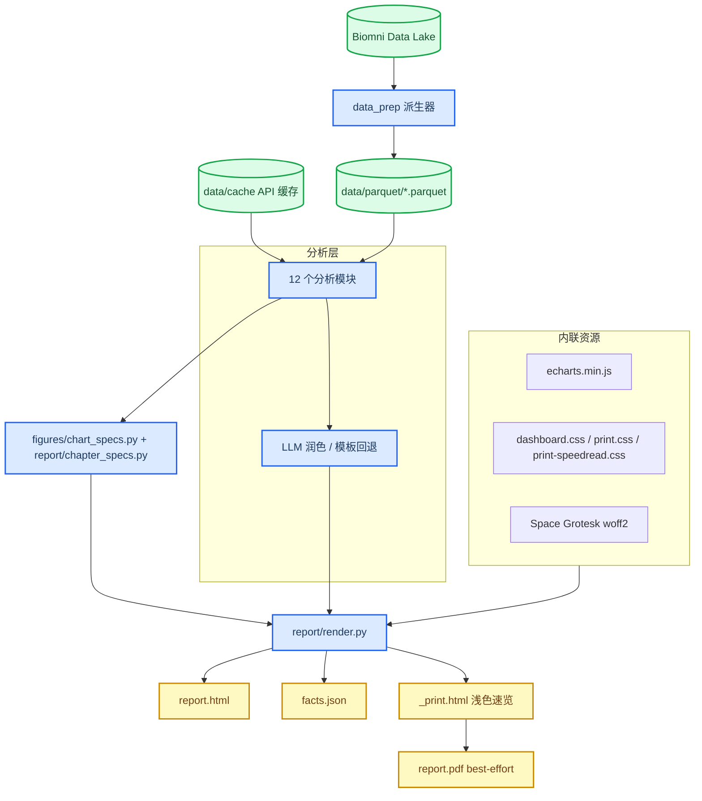
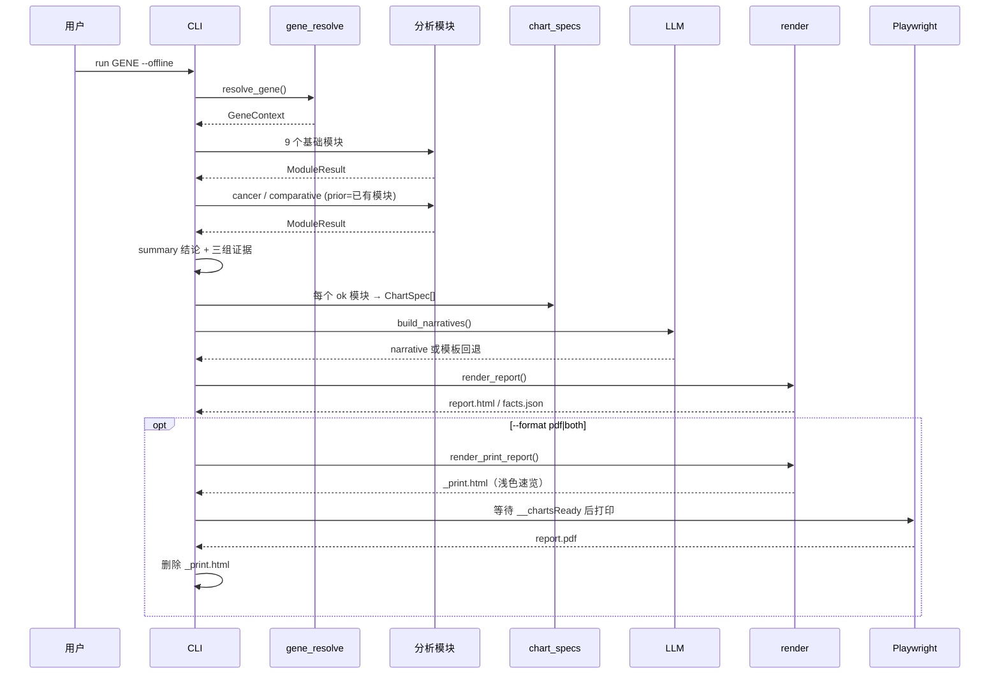

# Target Profiling

_单基因靶点画像报告生成器：本地数据优先、可离线、自包含 HTML，可选 PDF 与 LLM 润色。_

---

## 简介

Target Profiling 输入一个基因符号（也支持别名、Ensembl ID、UniProt ID），输出一份面向对外展示的单基因“全方位画像”报告。报告覆盖基因与蛋白基础、疾病关联、表达、突变、依赖性、癌症特征、通路与互作、蛋白修饰、可成药性、安全性、比较基因组学等维度，并在执行摘要中以结论横幅 + 三组关键证据呈现，阈值公开可追溯。

核心特点：

- **离线优先**：组织表达、DepMap、HPA、基因索引等数据预聚合成 Parquet；API 响应全部落盘缓存。报告生成阶段可直接 `--offline` 禁网。
- **自包含单文件**：ECharts 5.5.1、Space Grotesk 字体、CSS/JS 全部内联，`report.html` 无任何外部链接，可直接交付或归档。
- **速读优先**：网页每章按「KPI 条 → 结论 → 双列图表 → 核心表（默认 ≤8 行）→ 可展开明细」组织；PDF 是独立的浅色 4–5 页速览，只保留 8 张核心图和一张结论页。
- **事实驱动解读**：每个模块先产出结构化 `facts`，文字解读由规则模板生成；LLM 仅允许改写措辞，数字由守卫校验，失败自动回退模板。
- **严格降级**：单个维度缺数据时标记 `no_data` 并继续出报告，不因单点失败中断全流程。
- **商用许可可控**：只使用开放许可数据源；DisGeNET / OMIM / MSigDB 等明确列入 `not_for_delivery`，不进入交付物。

---

## 快速开始

> 需要分步图文教程（含实测截图）见 [`docs/USAGE.md`](docs/USAGE.md)。

### 前置条件

| 依赖 | 版本/说明 | 检查命令 |
| --- | --- | --- |
| Python | ≥ 3.13 | `python --version` |
| uv | 用于创建 `.venv` 与运行命令 | `uv --version` |
| Biomni Data Lake | 默认路径见 `config/settings.toml`，仅 `data` 命令需要 | 检查 `lake_root` 是否存在 |
| Playwright Chromium | 可选，仅 PDF 导出需要 | `uv run playwright install chromium` |
| 网络 | 仅首次 `fetch` 新基因时需要；`--offline` 运行不需要 | — |

> 环境包含 `ALL_PROXY=socks5h://...` 时，`httpx[socks]` 已在依赖中声明，无需额外处理。

### 安装与首次运行

```bash
cd /root/target_profiling
uv sync

# 1) 从本地 data lake 派生紧凑 Parquet（只需在数据源更新后重跑）
uv run target-profile data all

# 2) 预热某个基因的 API 缓存（首次需要联网）
uv run target-profile fetch KRAS

# 3) 离线生成报告（默认仅 HTML）
uv run target-profile run KRAS --offline --no-llm
```

产物位于：

```text
out/KRAS_YYYYMMDD/
├── report.html    # 自包含单文件报告（默认）
├── facts.json     # 全部模块的结构化事实
└── run.log        # 运行日志
```

需要 PDF 时：

```bash
uv run target-profile run KRAS --offline --no-llm --format pdf
# 或同时生成 HTML 与 PDF
uv run target-profile run KRAS --offline --no-llm --format both
```

`--format pdf|both` 会额外生成 `report.pdf`（浅色 A4 速览，通常 4–5 页）；导出用的临时文件 `_print.html` 在打印结束后自动删除。

**验证安装：**

```bash
uv run pytest
# 预期：112 passed（全离线 fixture，不访问网络）
```

---

## 命令行参考

入口命令为 `target-profile`，也可用 `uv run target-profile ...`。

### `run` — 生成报告

```bash
target-profile run GENE [OPTIONS]
```

| 选项 | 默认值 | 说明 |
| --- | --- | --- |
| `GENE` | 必填 | HGNC 符号、别名、Ensembl ID 或 UniProt ID |
| `--out PATH` | `out/<SYMBOL>_<YYYYMMDD>` | 指定输出目录 |
| `--format` | `html` | `html` \| `pdf` \| `both` |
| `--no-llm` | 关闭 LLM | 跳过 LLM 润色，直接使用规则模板 |
| `--force` | `false` | 覆盖已存在的输出目录 |
| `--offline` | `false` | 禁止任何网络访问，缓存缺失即降级/报错 |

退出码：

| 退出码 | 含义 |
| --- | --- |
| `0` | 成功 |
| `2` | 基因无法解析、参数非法、输出目录已存在且未加 `--force` |
| `3` | 必需本地数据缺失（缺 Parquet 等） |
| `4` | PDF 导出失败（HTML 仍保留） |

### `fetch` — 预热 API 缓存

```bash
target-profile fetch GENE [--refresh]
```

抓取 Open Targets（target/basic/pathways/disease/tractability/safety/cancer）、STRING、ClinVar、cBioPortal TCGA 突变、UniProt、AlphaFold 等响应并写入缓存。`--refresh` 强制重新请求。

### `data` — 派生本地 Parquet

```bash
target-profile data [all|SOURCE] [--force]
```

可用 `SOURCE`：`gtex`、`depmap_gene_effect`、`depmap_expression`、`depmap_model`、`hpa`、`gene_info`。`all` 会依次派生并写入 `data/manifest.json`（含来源、版本、许可、SHA256、行数）。

### `doctor` — 环境检查

```bash
target-profile doctor
```

汇总 `lake_root`、`data_root`、6 个 Parquet 是否存在、Playwright 是否可用。全部数据就绪时退出码 `0`，否则 `1`。

### `version` — 版本

```bash
target-profile version
```

---

## 输出与报告结构

### `report.html`

单文件、可离线打开。包含：

- 深色仪表盘布局、左侧章节目录与滚动高亮、顶部阅读进度条、基因符号水印
- 每章统一结构：KPI 条 → 一句结论 → 双列图表 → 核心表（默认 ≤8 行）→ `<details>` 折叠其余表格/指标/caveat/全文
- 内联 ECharts 图表与原始 JSON（`<script id="chart-data">`），共 18 张图
- 内联 `woff2` 字体，中文正文 + 英文图表标签
- 附录：数据来源/许可、标签阈值、缺失维度、LLM 使用情况、方法学局限

### `report.pdf`

仅在 `--format pdf|both` 时生成，为独立的**浅色速读版**（A4，通常 4–5 页）：

- 第 1 页：标题、关键 KPI、执行摘要结论
- 第 2–5 页：8 张核心图（表达、突变、依赖性、疾病、可成药性、安全性、通路、癌症特征）与精简解读
- 由 `print.html.j2` + `print-speedread.css` 渲染，图表为静态快照（无 tooltip）；导出失败时 HTML 仍保留，CLI 退出码为 `4`

### `facts.json`

```json
{
  "gene": {"symbol": "KRAS", "ensembl_id": "ENSG00000133703", "...": "..."},
  "generated_at": "2026-10-30T15:43:21+00:00",
  "llm": {"enabled": false, "used": 0, "cached": 0, "fallback": 0},
  "modules": {
    "mutation": {
      "status": "ok",
      "facts": {"overall_freq_pct": 6.96},
      "caveats": [],
      "charts": ["mutation-cancers", "mutation-proteins"],
      "narrative": "TCGA PanCancer 合并样本中 KRAS 的突变率为 6.96%……",
      "label_cards": []
    },
    "cancer": {
      "status": "ok",
      "facts": {"driver_status": "驱动证据阳性"},
      "caveats": ["cancer: 驱动状态为规则推导……"],
      "charts": ["cancer-hallmarks"],
      "narrative": "……",
      "label_cards": []
    }
  }
}
```

`modules.<name>.status` 为 `ok` 或 `no_data`；降级原因记录在 `caveats`。数据来源与版本清单存放在独立的 `data/manifest.json`。

### 报告章节

| 章节 | 模块 | 内容 |
| --- | --- | --- |
| 1. 执行摘要 | `summary` | 结论横幅 + 三组关键证据（阈值公开） |
| 2. 基因与蛋白基础 | `basic` | 靶点类别、长度、亚细胞定位、AlphaFold |
| 3. 疾病关联与遗传证据 | `disease` | Open Targets 疾病评分、pLI/LOEUF、ClinVar |
| 4. 表达 | `expression` | GTEx τ/组织分布、DepMap 细胞系表达、HPA |
| 5. 突变与变异 | `mutation` | TCGA 泛癌频率、癌种谱、蛋白改变、位点分布 |
| 6. 依赖性与癌症特征 | `dependency` + `cancer` | Chronos 效应、谱系、hallmarks、驱动状态 |
| 7. 通路与相互作用 | `pathway` | Reactome/GO、STRING 高置信互作 |
| 8. 蛋白修饰 | `ptm` | UniProt curated PTM、结构域/区域 |
| 9. 可成药性与药物 | `tractability` | 可成药性分级、化学探针、药物/临床阶段 |
| 10. 安全性与风险 | `safety` | 安全事件、IMPC 小鼠表型、必需性、LoF 约束 |
| 11. 比较基因组学 | `comparative` | 同源基因/旁系同源一致性 |
| 12. 药物基因组学/文献 | — | 预留占位，后续 Tier3 |

### 缓存目录

```text
data/cache/
├── <SYMBOL>/          # cBioPortal、STRING、ClinVar
├── <ENSG>/            # Open Targets target/basic/pathways/disease/tractability/safety/cancer
├── _global/           # UniProt、AlphaFold、Open Targets 搜索
└── _llm/              # LLM 解读缓存
```

每个 JSON 旁有 `.meta.json`（URL、方法、抓取时间）。缓存键固定，缺失时才联网；`--offline` 下缺失会抛出 `OfflineCacheMiss`，对应维度降级。

---

## 架构

### 系统总览

数据层从本地 Biomni Data Lake 派生 Parquet，API 层以“缓存优先”补齐在线维度；分析层统一产出 `ModuleResult`；图表层只把 `facts`/`tables` 转成纯 JSON 的 ECharts `option`；渲染层用 `chapter_specs.py` 统一章节/表头/标签的中文映射，再内联资源生成单文件 HTML。PDF 走独立渲染路径：`render_print_report()` 生成浅色 `_print.html`，Playwright 在图表就绪后打印，随后删除临时文件。



### `run` 数据流



### 分层依赖

`data_prep → parquet/manifest → analysis → figures/chart_specs → report`，单向依赖。`report/chapter_specs.py` 只做展示映射（章节、表头、标签、单位），不含计算；分析模块不感知 HTML，图表构建器不读原始数据，渲染层不计算结果。

---

## 数据源与许可

| 维度 | 数据源 | 本地形态 | 许可 |
| --- | --- | --- | --- |
| 表达 | GTEx v8、DepMap/CCLE、HPA | Parquet | CC BY 4.0 |
| 突变 | cBioPortal / TCGA PanCancer | API 缓存 JSON | Open access TCGA data |
| 依赖 | DepMap CRISPR (Chronos) | Parquet | CC BY 4.0 |
| 疾病/可成药性/安全性/癌症特征/同源 | Open Targets Platform v4 | API 缓存 JSON | CC0 1.0（上游逐项标注） |
| 通路/互作 | Reactome/GO（OT）、STRING | API 缓存 JSON | STRING 单物种 links：CC BY 4.0 |
| 蛋白修饰 | UniProt curated PTM | API 缓存 JSON | CC BY 4.0 |
| 疾病变异 | NCBI ClinVar | API 缓存 JSON | Public domain |
| 结构置信度 | AlphaFold DB | API 缓存 JSON | CC BY 4.0 |
| 图表 | Apache ECharts 5.5.1 | 内联 | Apache-2.0 |
| 字体 | Space Grotesk | 内联 woff2 | SIL OFL 1.1 |

许可登记见 `config/licenses.yaml`。明确不进入交付物的来源：

- DisGeNET
- OMIM
- MSigDB

> 商用交付前请复核 `config/licenses.yaml` 与 `data/manifest.json`，并按各来源要求署名。

---

## 配置与缓存

### `config/settings.toml`

```toml
lake_root = "/root/Biomni/Biomni/data/biomni_data/data_lake"
data_root = "data"
out_root = "out"

[thresholds]
tissue_specific_tau = 0.9
tissue_partial_tau = 0.6
pan_cancer_hotspot_pct = 5.0
strong_dependency_effect = -0.5
loeuf_constrained = 0.6
string_min_score = 0.7
expression_breadth_tpm = 1.0

[llm]
enabled = false
base_url = "https://api.openai.com/v1"
model = ""
api_key_env = "TARGET_PROFILE_LLM_API_KEY"
```

### 阈值说明

| 阈值 | 默认 | 用途 |
| --- | --- | --- |
| `tissue_specific_tau` | 0.9 | τ ≥ 该值判为“组织特异” |
| `tissue_partial_tau` | 0.6 | τ ≥ 该值判为“偏特异表达” |
| `pan_cancer_hotspot_pct` | 5.0 | 泛癌突变率 ≥ 该值视为高频/驱动规则阳性 |
| `strong_dependency_effect` | -0.5 | Chronos 效应 ≤ 该值视为强依赖 |
| `loeuf_constrained` | 0.6 | LOEUF < 该值视为强约束 |
| `string_min_score` | 0.7 | STRING 高置信互作阈值 |
| `expression_breadth_tpm` | 1.0 | 判定“可检测表达”的 TPM 下限 |

### 环境变量

| 变量 | 必需 | 说明 |
| --- | --- | --- |
| `TARGET_PROFILE_HOME` | 否 | 覆盖项目根目录（默认当前工作目录），测试与沙箱使用 |
| `TARGET_PROFILE_LLM_API_KEY` | LLM 启用时 | OpenAI 兼容接口密钥；变量名可在 `settings.toml` 改 |

### Parquet 数据

| 文件 | 内容 |
| --- | --- |
| `gtex.parquet` | GTEx 组织表达（约 100 万行） |
| `depmap_gene_effect.parquet` | CRISPR/Chronos 基因效应矩阵 |
| `depmap_expression.parquet` | CCLE 细胞系表达矩阵 |
| `depmap_model.parquet` | 细胞系元数据（谱系/疾病） |
| `hpa.parquet` | HPA 组织特异性与亚细胞定位 |
| `gene_info.parquet` | 基因索引（symbol/Ensembl/坐标/类型） |

`data/manifest.json` 记录每个派生文件的版本、许可、SHA256、行数。

---

## LLM 润色

默认关闭。启用方式：

```toml
[llm]
enabled = true
base_url = "https://api.openai.com/v1"
model = "gpt-4o-mini"
api_key_env = "TARGET_PROFILE_LLM_API_KEY"
```

```bash
export TARGET_PROFILE_LLM_API_KEY="sk-..."
uv run target-profile run KRAS --offline
```

工作方式：

1. 每个模块先用规则模板生成 `narrative` 草稿。
2. 调用 OpenAI 兼容 `/chat/completions`，要求只改写措辞，不新增/删除/修改事实。
3. `llm/guard.py` 提取输出中的所有数字，必须能在该模块 `facts` 中找到；越界即拒绝并重试一次。
4. 两次失败、网络错误或缺密钥 → 自动回退模板，报告仍完整生成。
5. 成功结果按 `(gene, facts, model, prompt_version)` 哈希缓存到 `data/cache/_llm/`。

报告附录会显示 LLM 状态：启用模型、新生成段数、缓存命中数、回退段数。

> `--no-llm` 优先级最高，即使配置启用也不会调用 LLM。

---

## 测试与开发

```bash
uv run pytest                 # 全量，全离线
uv run pytest tests/unit      # 单元测试
uv run pytest tests/integration/test_vertical_slice.py   # 端到端 + 自包含断言
uv run pytest tests/unit/test_print_report.py            # PDF 速览版结构与配色
```

测试约定：

- 所有测试使用 `tmp_path` 构造小 Parquet/JSON fixture，不访问网络。
- 集成测试通过 monkeypatch `socket.socket.connect` 强制断网。
- 关键断言包括：12 个模块状态、`chart-data` JSON、字体/图表内联、无 `http(s)` 外链、12 个章节锚点、网页双列布局与阅读进度条、PDF 5 页/8 图（降级时 4 页/3 图）、临时 `_print.html` 清理、PDF 失败保留 HTML 且退出码 `4`。
- 当前基线：**112 passed**。

真实数据验收命令：

```bash
uv run target-profile run KRAS --offline --no-llm --force
uv run target-profile run TP53 --offline --no-llm --force
```

参考基线：KRAS 泛癌 6.96%、G12D 197 次；TP53 泛癌 35.01%、R175H 150 次。

---

## 项目结构

```text
target_profiling/
├── config/
│   ├── settings.toml          # 路径、阈值、LLM
│   └── licenses.yaml          # 许可登记与禁交付来源
├── data/                      # Parquet、manifest、API 缓存（生成物）
├── out/                       # 报告产物
├── docs/superpowers/
│   ├── specs/                 # 设计文档
│   └── plans/                 # 实施计划
├── src/target_profile/
│   ├── cli.py                 # Typer 入口
│   ├── config.py              # Pydantic Settings
│   ├── models.py              # GeneContext / ChartSpec / ModuleResult
│   ├── gene_resolve.py        # 多 ID 解析
│   ├── api/                   # cache / opentargets / cbioportal / uniprot / stringdb / clinvar / alphafold
│   ├── data_prep/             # lake 派生器 + manifest
│   ├── analysis/              # 12 个分析模块
│   ├── figures/chart_specs.py # ECharts option 构建器
│   ├── llm/                   # client / prompts / guard / cache
│   └── report/
│       ├── render.py          # 网页/速览两套上下文组装、资源内联
│       ├── chapter_specs.py   # 章节、表头、标签、KPI 单位的中文映射
│       ├── pdf.py             # Playwright 打印（best-effort）
│       ├── templates/         # report.html.j2 / print.html.j2
│       ├── static/            # dashboard.css / print.css / print-speedread.css / dashboard.js
│       └── vendor/            # ECharts + Space Grotesk
└── tests/
    ├── unit/                  # 模块、图表、LLM、渲染、PDF 速览
    └── integration/           # 端到端离线 + 自包含验收
```

---

## 故障排查

### `missing local data: .../parquet/...`

**原因**：尚未派生本地数据，或 `data_root` 配置错误。

**处理**：

```bash
uv run target-profile doctor
uv run target-profile data all
```

### `offline: missing cache ...`

**原因**：`--offline` 下某维度缓存不存在（常见于新基因或新增维度，例如 `opentargets_cancer.json`）。

**处理**：去掉 `--offline` 先联网跑一次，或先执行：

```bash
uv run target-profile fetch GENE
```

### PDF 导出失败（退出码 4）

**原因**：Chromium 未安装、页面脚本未就绪或打印超时。

**处理**：

```bash
uv run playwright install chromium
uv run target-profile run GENE --format pdf --force
```

HTML 始终保留；PDF 为 best-effort，不阻塞主流程。

### `output exists: ...; use --force`

**原因**：默认输出目录已存在（按 `SYMBOL_YYYYMMDD` 命名）。

**处理**：加 `--force`，或用 `--out` 指定新目录。

### 网络请求失败 / 代理问题

**原因**：环境配置了 SOCKS 代理或 API 临时不可用。

**处理**：

- 确认 `httpx[socks]` 已随 `uv sync` 安装
- 单维度失败通常只降级该维度；可重试 `fetch GENE`
- 无网络时使用 `--offline` 配合已有缓存

### 报告中某章显示“无数据”

**原因**：对应模块 `status=no_data`，例如缺少该基因的 Open Targets 缓存、STRING 无高置信伙伴、IMPC 无表型等。

**处理**：先 `fetch GENE` 补齐缓存；某些维度天然稀疏（安全事件、罕见病关联），无记录不代表阴性结论。

### LLM 未生效

**检查**：

1. `settings.toml` 中 `llm.enabled = true` 且 `model` 非空
2. 环境变量 `TARGET_PROFILE_LLM_API_KEY` 已设置
3. 未传入 `--no-llm`
4. 查看报告附录或 `run.log` 中的 `error` / `fallback` 信息

---

## 已知限制

- **驱动状态为规则推导**：Open Targets v4 未提供 `isCancerDriverGene` 字段。当前以“泛癌突变率 ≥ 阈值”或“命中 cancer hallmark”判定，报告 caveat 中会明确说明。
- **安全性数据天然稀疏**：无安全事件记录不等于安全；IMPC 小鼠表型仅作参考。
- **第 12 章为占位**：药物基因组学/文献整合属于后续 Tier3。
- **互作网络范围有限**：STRING 仅保留高置信（≥0.7）伙伴，缓存通常取 Top100。
- **数据版本取决于本地 lake**：GTEx v8、DepMap 等版本由 Biomni data lake 决定，换库后需重跑 `data` 与 `doctor`。
- **PDF 是精简速览，不是网页全文**：默认只生成 HTML；`--format pdf|both` 输出 4–5 页浅色速览，仅含关键 KPI、结论和 8 张核心图，完整表格与明细只在网页版。
- **PDF 图表为静态快照**：导出时把 ECharts 画布转成 PNG，因此 PDF 内无 tooltip/交互；需要交互请使用 `report.html`。PDF 还依赖 Playwright Chromium。
- **暂未提供批量与网页入口**：当前为单基因 CLI；架构保留了扩展空间。
- **项目不使用 git 流程**：按当前约定，开发过程不做提交/分支操作。

---

## 参考

- 设计文档：`docs/superpowers/specs/2026-10-30-target-profiling-design.md`
- UI 重设计：`docs/superpowers/specs/2026-10-30-target-profiling-ui-redesign-design.md`
- 报告重设计实施计划：`docs/superpowers/plans/2026-11-03-report-redesign.md`
- 其他实施计划：`docs/superpowers/plans/`
- Apache ECharts：<https://echarts.apache.org/>
- Open Targets Platform：<https://platform.opentargets.org/>
- GTEx Portal：<https://gtexportal.org/>
- DepMap：<https://depmap.org/>
- Human Protein Atlas：<https://www.proteinatlas.org/>
- STRING：<https://string-db.org/>
- UniProt：<https://www.uniprot.org/>
- ClinVar：<https://www.ncbi.nlm.nih.gov/clinvar/>
- AlphaFold DB：<https://alphafold.ebi.ac.uk/>

---

_Last updated: 2026-11-03_
