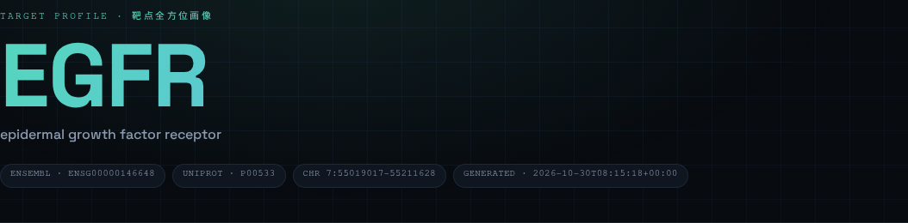
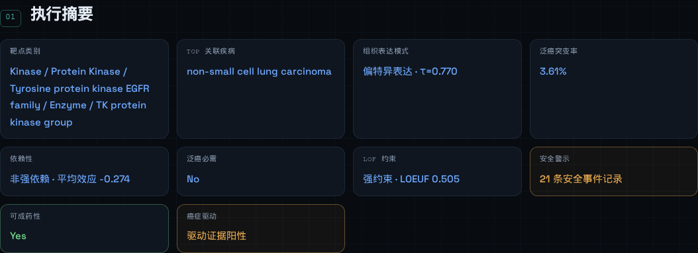
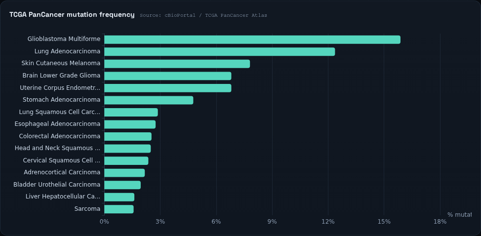
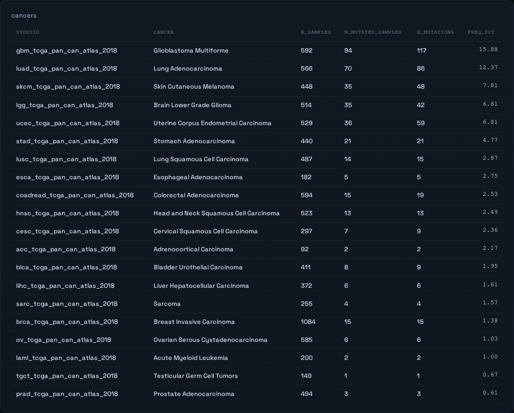
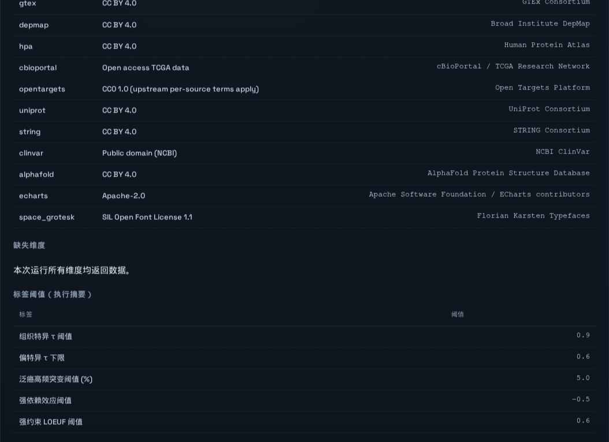

# Target Profiling 使用指南

从零生成一个基因的靶点画像报告。示例基因为 **EGFR**（本文所有截图均来自该次实测）。

---

## 0. 快速上手（TL;DR）

```bash
cd /root/target_profiling
uv run target-profile doctor
uv run target-profile fetch EGFR
uv run target-profile run EGFR --offline --no-llm
# 打开 out/EGFR_<日期>/report.html
```

---

## 1. 前置检查

```bash
cd /root/target_profiling
uv run target-profile doctor
```

预期输出（当前环境）：

```text
lake_root: /root/Biomni/Biomni/data/biomni_data/data_lake
data_root: /root/target_profiling/data
OK  /root/target_profiling/data/parquet/gtex.parquet
OK  /root/target_profiling/data/parquet/depmap_gene_effect.parquet
OK  /root/target_profiling/data/parquet/depmap_expression.parquet
OK  /root/target_profiling/data/parquet/depmap_model.parquet
OK  /root/target_profiling/data/parquet/hpa.parquet
OK  /root/target_profiling/data/parquet/gene_info.parquet
OK  playwright
```

退出码 `0` 表示 6 个 Parquet 与 Playwright 均就绪。出现 `MISS` 见第 5 节。

> 路径以**当前工作目录**为基准，务必先 `cd` 到项目根目录；或在任意目录设置 `export TARGET_PROFILE_HOME=/root/target_profiling`。

---

## 2. 新环境的一次性准备

```bash
uv sync
uv run playwright install chromium   # 仅 PDF 需要

# 仅当本地 data lake 更新后才需要重跑
uv run target-profile data all
```

`data all` 会从 Biomni Data Lake 派生 6 个 Parquet 到 `data/parquet/`（约 289 MB），并写入 `data/manifest.json`（版本、许可、SHA256、行数）。日常生成报告不需要执行。

---

## 3. 生成报告的完整流程（EGFR 实测）

### 3.1 选择基因输入

CLI 自动解析四种写法：

| 输入类型 | 示例 |
| --- | --- |
| HGNC 符号 | `EGFR` |
| 别名 | `HER1`、`p53` |
| Ensembl ID | `ENSG00000146648` |
| UniProt ID | `P00533` |

无法解析时退出码 `2`。

### 3.2 预热 API 缓存（新基因首次）

```bash
uv run target-profile fetch EGFR
```

实测输出：

```text
cached: Open Targets target
cached: Open Targets basic
cached: Open Targets pathways
cached: Open Targets disease
cached: Open Targets tractability
cached: Open Targets safety
cached: Open Targets cancer
cached: STRING partners
cached: UniProt record
cached: AlphaFold prediction
cached: cBioPortal TCGA mutations
cached: ClinVar records
cached gene: EGFR
```

说明：

- 单个维度失败只打印 `warning`，不会中断；可重复执行补齐。
- 缓存位置：`data/cache/<SYMBOL>/`、`data/cache/<ENSG>/`、`data/cache/_global/`，每个 JSON 旁有 `.meta.json`（URL、方法、抓取时间）。
- 想强制刷新：`fetch EGFR --refresh`。
- 已有缓存的基因（如 KRAS、TP53、EGFR）可跳过。

> `run` 在非 `--offline` 模式下也会按需联网抓取；`fetch` 的价值是把网络阶段单独隔离、失败可重试。

### 3.3 生成报告

```bash
uv run target-profile run EGFR --offline --no-llm
```

实测输出：

```text
2026-10-30 16:15:18 INFO wrote /root/target_profiling/out/EGFR_20261030/report.html
2026-10-30 16:15:18 INFO wrote /root/target_profiling/out/EGFR_20261030/facts.json
report: /root/target_profiling/out/EGFR_20261030/report.html
```

产物：

```text
out/EGFR_20261030/
├── report.html    # 自包含单文件报告（默认唯一产物，约 1.2 MB）
├── facts.json     # 全部模块的结构化事实（约 15 KB）
├── report.pdf     # 仅 --format pdf|both 时生成
└── run.log        # 运行日志
```

常用参数：

| 参数 | 说明 |
| --- | --- |
| `--offline` | 禁止联网，缓存缺失则对应维度降级 |
| `--no-llm` | 跳过 LLM 润色（优先级最高） |
| `--format html\|pdf\|both` | 默认 `html` |
| `--force` | 覆盖当天已存在的输出目录 |
| `--out PATH` | 自定义输出目录 |

> 默认目录按 `out/<SYMBOL>_<YYYYMMDD>` 命名，同一天重复运行必须加 `--force`。

### 3.4 查看报告

`report.html` 内联了 ECharts 5.5.1、Space Grotesk 字体、CSS/JS，**无任何外链**：下载到本地双击即可打开，也可以直接归档交付。



左侧为章节目录，滚动时高亮；正文共 12 章 + 附录。

**第 1 章 执行摘要**：阈值公开的事实标签卡，先看这里判断靶点画像的整体轮廓。



EGFR 实测要点：非小细胞肺癌为最高关联疾病；泛癌突变率 3.61%；偏特异表达（τ=0.770）；LOEUF 0.505；21 条安全事件记录；可成药；驱动证据阳性（规则推导）。

**第 5 章 突变与变异**：癌种分布以横向条形图呈现，下方附完整癌种表。





EGFR 实测：GBM 15.88%（94/592）、LUAD 12.37%（70/566）、SKCM 7.81%。

**附录**：数据源与许可、缺失维度、阈值说明、LLM 状态。



### 3.5 核对数据质量

不要只看图，先看 `facts.json` 的模块状态与 caveat：

```bash
uv run python - <<'PY'
import json
d = json.load(open("out/EGFR_20261030/facts.json"))
for name, m in d["modules"].items():
    print(f'{name:12} {m["status"]:8} caveats={len(m["caveats"])}')
    for c in m["caveats"]:
        print("   -", c)
print("llm:", d["llm"])
PY
```

EGFR 实测 12 个模块全部 `ok`；3 条预期 caveat（ClinVar 分类、驱动状态为规则推导、安全数据稀疏）。

- `status=ok`：维度正常。
- `status=no_data`：该维度缺数据，报告中显示“暂无可用数据”，原因写入 `caveats`，不影响其他章节。
- 天然稀疏的维度：安全事件、罕见病关联、STRING 高置信伙伴。

### 3.6 导出 PDF（可选）

```bash
uv run target-profile run EGFR --offline --no-llm --format pdf --force
# 或 HTML + PDF
uv run target-profile run EGFR --offline --no-llm --format both --force
```

PDF 为 best-effort：失败时退出码 `4`，但 `report.html` 始终保留。本机未安装 `pdftoppm`，视觉检查请用 Playwright 截图 HTML。

---

## 4. 常用场景

### 4.1 批量生成

```bash
for g in EGFR BRAF ALK MET; do
  echo "=== $g ==="
  uv run target-profile fetch "$g" || true
  uv run target-profile run "$g" --offline --no-llm --force
done
```

产物分别在 `out/<GENE>_<日期>/`；某基因 fetch 缺项只降级对应章节。

### 4.2 启用 LLM 润色

编辑 `config/settings.toml`：

```toml
[llm]
enabled = true
base_url = "https://api.openai.com/v1"
model = "gpt-4o-mini"
api_key_env = "TARGET_PROFILE_LLM_API_KEY"
```

```bash
export TARGET_PROFILE_LLM_API_KEY="sk-..."
uv run target-profile run EGFR --offline --force
```

- `--offline` 只禁数据抓取，LLM 调用仍然可用；`--no-llm` 才禁 LLM。
- 输出数字经 `llm/guard.py` 校验，越界或调用失败自动回退规则模板。
- 结果缓存于 `data/cache/_llm/`；报告附录显示新增/缓存命中/回退统计。

### 4.3 换数据源或调阈值

- 数据源路径、阈值、LLM 配置：`config/settings.toml`
- 许可登记与禁交付来源：`config/licenses.yaml`
- 数据版本清单：`data/manifest.json`

---

## 5. 退出码与排障

| 退出码 | 含义 | 处理 |
| --- | --- | --- |
| `0` | 成功 | — |
| `2` | 基因无法解析 / 参数非法 / 输出目录已存在 | 检查拼写；加 `--force` 或 `--out` |
| `3` | 必需本地数据缺失（Parquet 等） | `uv run target-profile data all` |
| `4` | PDF 导出失败（HTML 已保留） | 安装 Chromium 后重跑；或只用 HTML |

| 现象 | 原因与处理 |
| --- | --- |
| `missing local data: .../parquet/...` | 未派生数据或工作目录不对；跑 `doctor` 和 `data all` |
| `offline: missing cache ...` | 该维度无缓存；去掉 `--offline` 跑一次，或 `fetch GENE` |
| 某章“无数据” | `fetch GENE` 补齐；部分维度天然稀疏，无记录 ≠ 阴性结论 |
| 网络 / 代理报错 | 确认 `httpx[socks]` 已安装；`fetch` 可重试，单维度失败会降级 |
| LLM 未生效 | 核对 `enabled`、`model`、密钥环境变量、未加 `--no-llm`，再看 `run.log` |
| 同一天重跑报 `output exists` | 加 `--force` |

---

## 6. 验收基线

```bash
uv run pytest                                        # 预期 86 passed，全程离线
uv run target-profile run KRAS --offline --no-llm --force
uv run target-profile run TP53 --offline --no-llm --force
```

关键数字应与基线一致：

| 指标 | KRAS | TP53 |
| --- | --- | --- |
| 泛癌突变率 | 6.96% | 35.01% |
| 最高频蛋白改变 | G12D 197 次 | R175H 150 次 |
| 蛋白长度 | 189 aa | 393 aa |
| PTM 位点 | 11 | 36 |
| 强依赖细胞系 | 406 | 非依赖（中位效应 +0.231） |

EGFR（本文实测）：泛癌 3.61%，GBM 15.88%，τ=0.770，Reactome 通路与 STRING Top 伙伴见第 7 章。

---

## 7. 产物与目录速查

```text
target_profiling/
├── config/settings.toml       # 路径、阈值、LLM
├── config/licenses.yaml       # 许可与禁交付来源
├── data/parquet/              # 派生数据（约 289 MB）
├── data/cache/                # API 缓存（按基因/ENSG/_global/_llm）
├── out/<SYMBOL>_<日期>/       # 报告四件套
├── docs/USAGE.md              # 本指南
└── docs/images/               # 本指南截图
```

相关文档：项目根 `README.md`、`docs/superpowers/specs/`、`docs/superpowers/plans/`。
